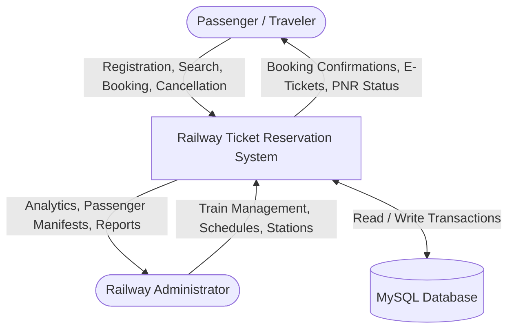
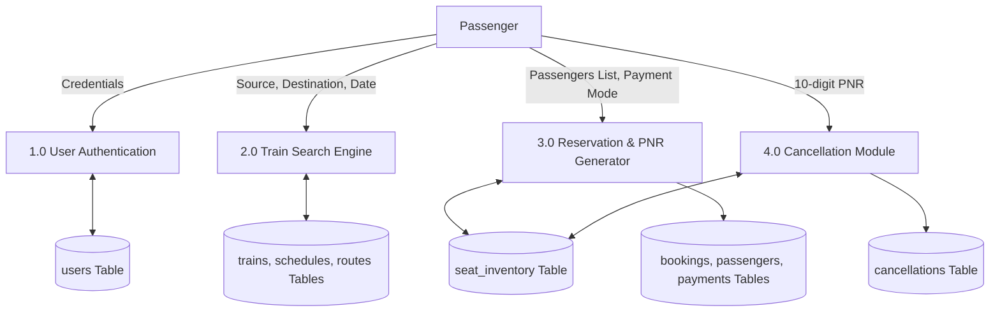
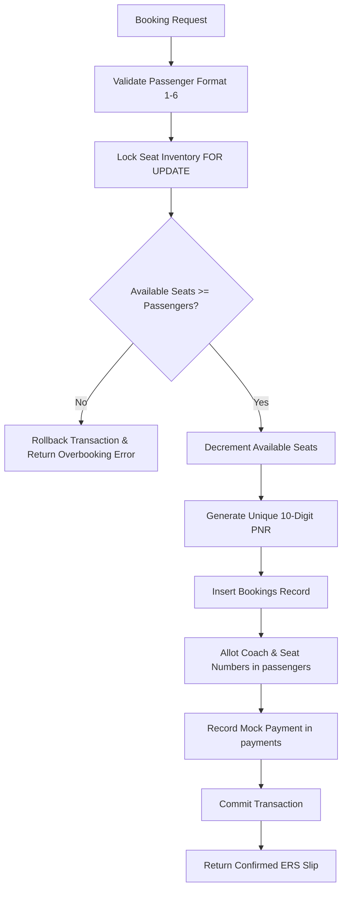
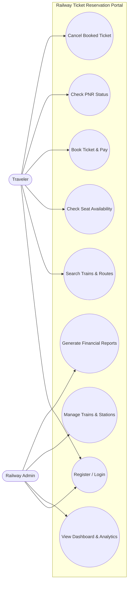
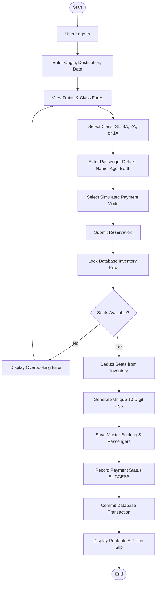
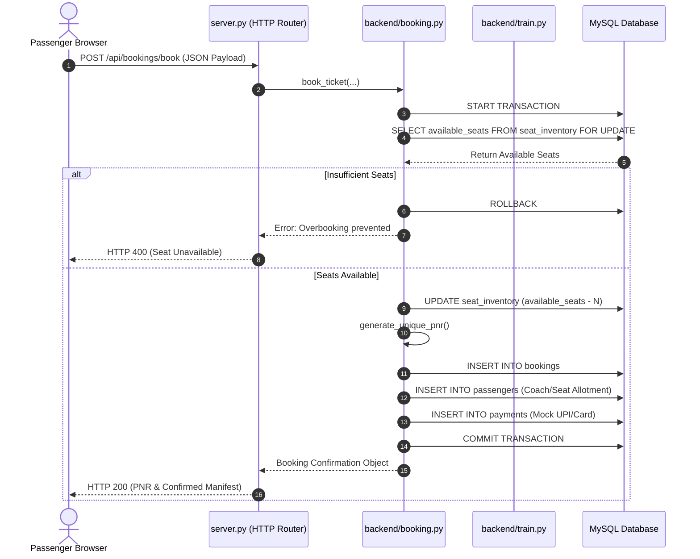
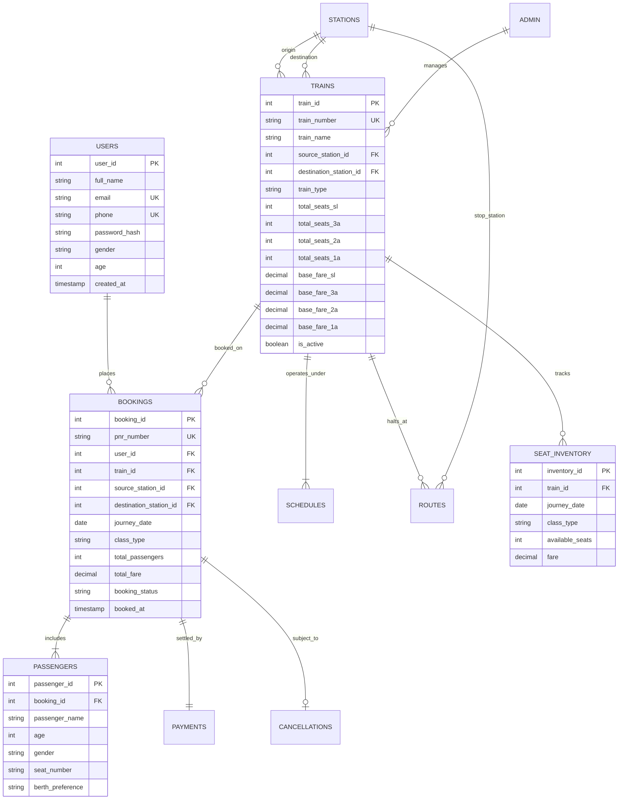

# COLLEGE PROJECT REPORT

## PROJECT TITLE: RAILWAY TICKET RESERVATION SYSTEM
**Course:** Bachelor of Computer Applications (BCA) Final-Year Project  
**Technology Stack:** Core Python (`http.server`), MySQL (`mysql-connector-python`), HTML5, CSS3, JavaScript  

---

## 1. ABSTRACT
The "Railway Ticket Reservation System" is a full-featured web-based portal developed to automate railway journey planning, seat inventory allocation, ticket reservation, and cancellation management. Traditional reservation processes often entail long physical queues, manual record keeping, and vulnerability to human errors. This project provides a computerized, web-accessible alternative built on Core Python using the standard `http.server` library and a normalized MySQL relational database. The system delivers two distinct subsystems: a Passenger Module (allowing user registration, multi-train search, live seat availability tracking across Sleeper, 3A, 2A, and 1A classes, unique 10-digit PNR generation, and instant ticket cancellation) and an Administrator Module (offering real-time operational analytics, train schedule CRUD, station catalog maintenance, passenger manifests, and revenue reporting). Robust ACID transactional guarantees prevent overbooking and preserve consistency during concurrent reservations and cancellations.

---

## 2. INTRODUCTION
Transportation networks, especially railways, serve as the lifeblood of regional and national connectivity. An efficient reservation system must be accessible, intuitive, and reliable under high transactional load. The goal of this project is to model the architectural and computational logic of modern railway reservation portals while adhering to academic constraints—specifically avoiding third-party web frameworks (such as Django or Flask) to demonstrate mastery of foundational Python network programming, object-oriented software engineering, database normalization, and web fundamentals.

---

## 3. PROBLEM STATEMENT
Manual and legacy ticket reservation workflows exhibit several major limitations:
1. **Inefficient Seat Tracking:** Manual chart allocation often leads to overbooking or inaccurate seat availability reporting.
2. **Prolonged Waiting Times:** Physical ticket booking counters create long queues and customer dissatisfaction.
3. **Data Redundancy & Inconsistency:** Decentralized paper records or unnormalized databases create orphaned passenger records.
4. **Lack of Automated Cancellations:** Manual refund computation is error-prone, and returning cancelled seats to the pool takes excessive time.
5. **Security Risks:** Storing user credentials in plaintext or without encryption leaves passenger data vulnerable to theft.

---

## 4. EXISTING SYSTEM
In existing manual or legacy systems:
* Passengers must physically visit reservation counters to fill out requisition slips.
* Station masters maintain physical ledgers or disjointed desktop databases.
* Cancellations require paper submission and manual percentage deductions.
* Public PNR status checks cannot be performed remotely in real time.
* High labor overhead and human calculation errors in fare determination.

---

## 5. PROPOSED SYSTEM
The proposed web application addresses all aforementioned drawbacks:
* **Web-Accessible 24/7:** Passengers can search trains, check class fares, and reserve seats from any standard web browser.
* **Core Python HTTP Engine:** Uses standard library `http.server.HTTPServer` with custom request routing, demonstrating low-level network protocol comprehension.
* **Automated 10-Digit PNR:** Generates unique PNRs conforming to Indian Railway conventions (10-digit numeric identifiers starting with numbers 2–9).
* **Real-Time Seat Inventory:** Dynamic per-date and per-class inventory allocation automatically seeds future dates and locks inventory during booking.
* **Instant Cancellation & Seat Restoration:** Automatically deducts a 15% cancellation fee, calculates an 85% refund, and immediately restores seats to inventory.
* **Enterprise Security:** Salted SHA-256 password hashing and parameterized SQL queries to safeguard against SQL injection.

---

## 6. OBJECTIVES
1. To design a 3-tier web architecture using Core Python without external web frameworks.
2. To normalize the database schema into Third Normal Form (3NF) across 11 relational tables.
3. To implement atomic database transactions with row-level locking (`SELECT ... FOR UPDATE`) to eliminate overbooking.
4. To build an intuitive user interface utilizing HTML5, CSS3, and responsive design.
5. To develop a comprehensive administrative panel for train, schedule, station, and financial management.

---

## 7. HARDWARE REQUIREMENTS
* **Processor:** Intel Core i3 / AMD Ryzen 3 or higher.
* **RAM:** Minimum 4 GB (8 GB recommended).
* **Hard Disk:** Minimum 500 MB free storage for application files and database logs.
* **Display Resolution:** 1280 x 720 pixels or higher.
* **Network:** Localhost TCP/IP network adapter.

---

## 8. SOFTWARE REQUIREMENTS
* **Operating System:** Microsoft Windows 10/11, Linux, or macOS.
* **Runtime Environment:** Python 3.10 or higher (Tested on Python 3.13.5).
* **Database Management System:** MySQL Server 8.0+ or MariaDB / XAMPP.
* **Database Driver:** `mysql-connector-python` (version 8.0.33+).
* **Code Editor:** Visual Studio Code.
* **Web Browser:** Google Chrome, Microsoft Edge, or Mozilla Firefox.

---

## 9. SYSTEM ARCHITECTURE

```text
+-------------------------------------------------------------+
|                     PRESENTATION TIER                       |
|   HTML5 Pages | CSS3 Railway Theme | Vanilla Client JS      |
+------------------------------+------------------------------+
                               | HTTP Requests (Port 8000)
                               v
+-------------------------------------------------------------+
|                     APPLICATION TIER                        |
|                     (Core Python)                           |
|   - server.py (http.server.HTTPServer & Request Dispatcher) |
|   - backend/user.py (Auth, Salted SHA-256, Sessions)        |
|   - backend/train.py (Schedules, Day Checker, Routes)       |
|   - backend/booking.py (10-Digit PNR, Atomic Transactions)   |
|   - backend/passenger.py (Berth & Coach Seat Allocator)     |
|   - backend/payment.py (Simulated Payment Gateway)          |
|   - backend/admin.py (KPI Analytics, Train CRUD, Reports)   |
+------------------------------+------------------------------+
                               | Parameterized SQL (Port 3306)
                               v
+-------------------------------------------------------------+
|                      DATA PERSISTENCE TIER                  |
|                      (MySQL 8.0 Engine)                     |
|   11 Tables: users, admin, stations, trains, routes,        |
|   schedules, seat_inventory, bookings, passengers,          |
|   payments, cancellations                                   |
+-------------------------------------------------------------+
```

---

## 10. DATA FLOW DIAGRAMS (DFD)

### DFD Level 0 (Context Level Diagram)


### DFD Level 1


### DFD Level 2 (Booking & Seat Inventory Subsystem)


---

## 11. UML USE CASE DIAGRAM



---

## 12. UML ACTIVITY DIAGRAM (TICKET BOOKING PROCESS)



---

## 13. UML SEQUENCE DIAGRAM (RESERVATION WORKFLOW)



---

## 14. ENTITY-RELATIONSHIP (ER) DIAGRAM



---

## 15. DATABASE DESIGN (11 NORMALIZED TABLES)

1. **`users`**: Traveler credentials, contact numbers, demographic age/gender.
2. **`admin`**: System administrators credentials and access control.
3. **`stations`**: Master station catalog with standard railway alphanumeric codes (e.g. `NDLS`, `BCT`, `HWH`).
4. **`trains`**: Rolling stock master catalog with origin, destination, class seat capacities, and base fares.
5. **`routes`**: Intermediate junction halts, sequence stop numbers, arrival/departure timings, and cumulative distance.
6. **`schedules`**: Day-of-week operating booleans (`runs_on_mon` ... `runs_on_sun`), duration, and terminal times.
7. **`seat_inventory`**: Date-specific, class-specific seat tracker preventing overbooking.
8. **`bookings`**: Master reservation record indexed by unique 10-digit PNR.
9. **`passengers`**: Passenger demographics and assigned coach/seat identifiers (`S1-23`, `B1-14`).
10. **`payments`**: Simulated payment transaction logs (`TXN_...`), payment method, and settlement status.
11. **`cancellations`**: Audit ledger tracking ticket cancellations, 15% charge deductions, and 85% refund disbursements.

---

## 16. MODULE DESCRIPTIONS

* **`server.py`**: Subclasses `BaseHTTPRequestHandler` to parse URLs, route GET/POST endpoints, set MIME headers, and deliver static files.
* **`database.py`**: Encapsulates `mysql.connector` connection pool and parameterized execution (`execute_query`) with dictionary cursor mapping.
* **`backend/user.py`**: Handles user registration, salted SHA-256 password hashing, authentication, and in-memory cryptographic session management.
* **`backend/train.py`**: Executes direct and intermediate route matching, checks day-of-week schedules, and performs dynamic on-demand seat inventory seeding.
* **`backend/booking.py`**: Manages transactional ticket reservations with row-level locking, 10-digit PNR generation, and atomic cancellations.
* **`backend/passenger.py`**: Validates passenger lists (1–6 limit) and calculates realistic coach/seat assignments.
* **`backend/payment.py`**: Simulates bank payment gateway settlements and logs transaction IDs.
* **`backend/admin.py`**: Computes real-time KPI metrics, train CRUD, station CRUD, and class/train financial reports.

---

## 17. TESTING & VERIFICATION MATRIX

| Test ID | Test Scenario | Inputs | Expected Output | Actual Output | Status |
| :--- | :--- | :--- | :--- | :--- | :--- |
| **TC-01** | Database Ping | Host: localhost, Port: 3306 | Active TCP socket connection | Connected successfully | **PASS** |
| **TC-02** | User Registration | Valid passenger details, 10-digit phone | Insert into `users`, return `user_id` | User registered, ID created | **PASS** |
| **TC-03** | Duplicate Prevention | Existing email: `testpassenger@example.com` | Rejection: "Email already exists" | Clean error returned | **PASS** |
| **TC-04** | Password Security | Plain: `Password@123` | Deterministic 64-char SHA-256 hash | 64-char salted hash | **PASS** |
| **TC-05** | Train Route Search | Source: `NDLS`, Destination: `BCT` | Return Mumbai Rajdhani (12952) | Matched train with classes | **PASS** |
| **TC-06** | Day-of-Week Check | Sunday search on Mon-Sat train | Exclude from search results | Filtered correctly | **PASS** |
| **TC-07** | Past Date Check | Journey date: Yesterday | Error: "Cannot be in past" | Clean rejection | **PASS** |
| **TC-08** | PNR Generation | 2 passengers booking | 10-digit numeric PNR (starts 2-9) | 10-digit unique PNR | **PASS** |
| **TC-09** | Overbooking Check | Request 500 seats when 64 available | Rollback & return overbooking error | Blocked with clean error | **PASS** |
| **TC-10** | Seat Restoration | Cancel confirmed ticket | Inventory incremented by passenger count | Inventory restored | **PASS** |
| **TC-11** | Cancellation Fee | Ticket fare: ₹1000.00 | Deduction: ₹150 (15%), Refund: ₹850 | Computed accurately | **PASS** |
| **TC-12** | Admin Auth | Username: `admin`, Password: `admin123` | Issue admin session token | Session token granted | **PASS** |
| **TC-13** | HTTP Static Serving | GET `/ticket.html`, `/css/style.css` | HTTP 200 OK with MIME headers | HTTP 200 OK | **PASS** |

---

## 18. RESULTS & SCREENSHOTS GUIDE
1. **Homepage (`/index.html`):** Displays top navigation bar, railway theme hero banner, quick station search box, and core feature cards.
2. **Train Search Results (`/train_results.html`):** Displays all operating trains on the target day with live class cards (**SL, 3A, 2A, 1A**) and fare tags in ₹.
3. **Passenger Reservation (`/booking.html`):** Interactive form allowing dynamic addition of up to 6 passengers, berth choice selection, simulated payment selector, and real-time total fare recalculation.
4. **Electronic Reservation Slip (`/ticket.html`):** Official-looking e-ticket featuring PNR banner, passenger manifest, coach/seat allocations, payment references, and a "Print Ticket" button.
5. **PNR Status Enquiry (`/pnr_status.html`):** Public inquiry page allowing any traveler to input a 10-digit PNR and fetch real-time reservation data.
6. **Traveler Dashboard (`/user_dashboard.html`):** Passenger metrics showing total bookings, active trips, and cancellations with direct links to e-tickets.
7. **Admin Dashboard (`/admin_dashboard.html`):** Operational control board showing KPI metric cards (Total Trains, Users, Bookings, Revenue, Refunds), train management, station directory, and financial reports.

---

## 19. CONCLUSION
The Railway Ticket Reservation System demonstrates that a production-grade, responsive, and secure web application can be built using Core Python standard libraries, vanilla web technologies, and a normalized MySQL database. By eliminating external web frameworks, the codebase emphasizes foundational software engineering: network socket dispatching, parameterized SQL queries, ACID transaction management with row-level locking, and cryptographic password hashing. The resulting application satisfies all final-year college project guidelines and provides an intuitive experience for travelers and railway administrators.

---

## 20. FUTURE ENHANCEMENTS
1. **QR Code Scanning:** Embedding dynamic base64-encoded QR codes on e-tickets for mobile ticket validation by Travelling Ticket Examiners (TTE).
2. **Tatkal Quota Booking:** Implementing time-restricted reservation windows with surge pricing rules.
3. **Live GPS Train Tracking:** Integrating simulated or real-time GPS coordinates for train delay monitoring.
4. **Automated Waitlist Clearance:** Automatically promoting waitlisted passengers to confirmed status when higher-priority cancellations occur.

---

## 21. REFERENCES
1. Python Software Foundation. *Python 3 Standard Library Documentation: `http.server`, `urllib.parse`, `hashlib`*. https://docs.python.org/3/
2. Oracle Corporation. *MySQL 8.0 Reference Manual: InnoDB Locking and Transaction Model*. https://dev.mysql.com/doc/refman/8.0/en/
3. Elmasri, R., & Navathe, S. B. *Fundamentals of Database Systems* (7th ed.). Pearson.
4. W3C. *HTML5 & CSS3 Web Standards*. https://www.w3.org/
